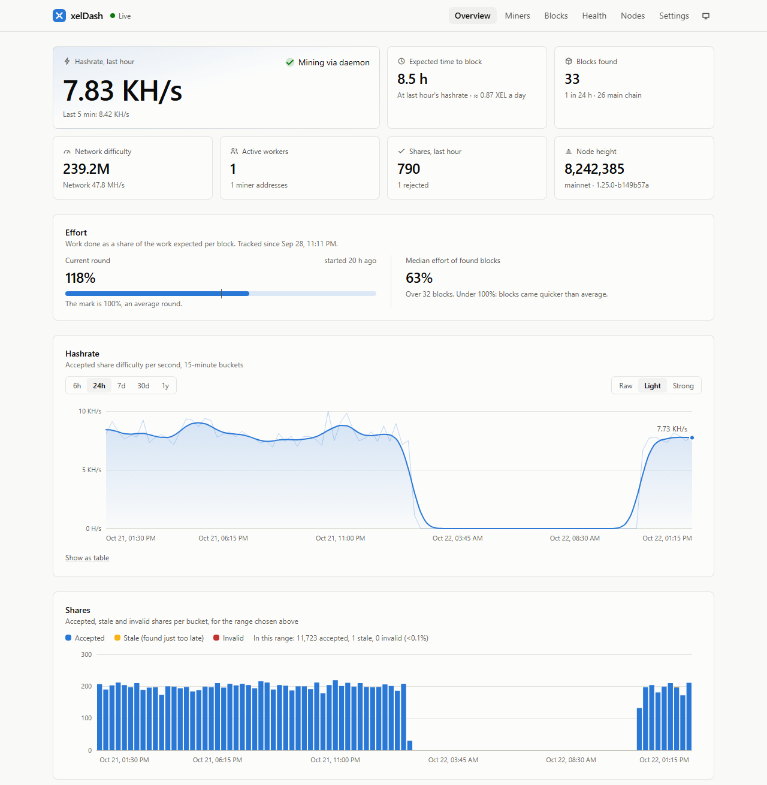
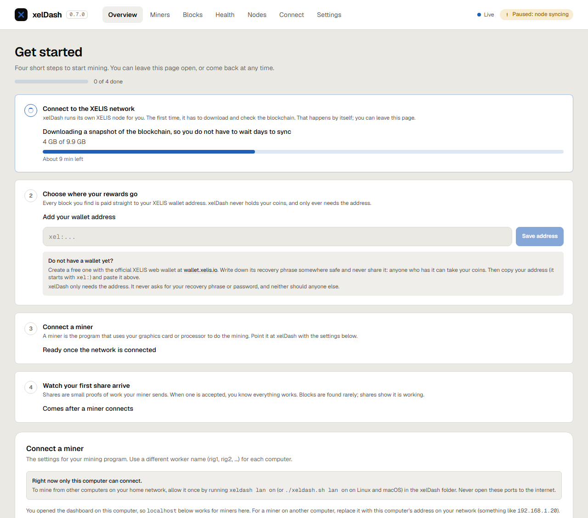
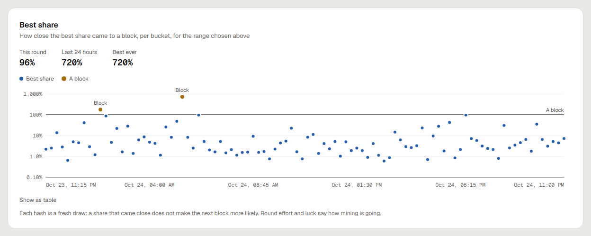
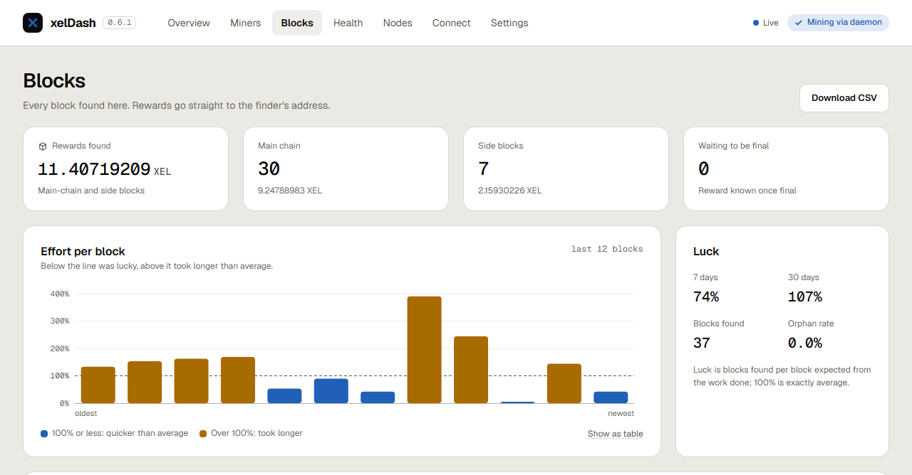
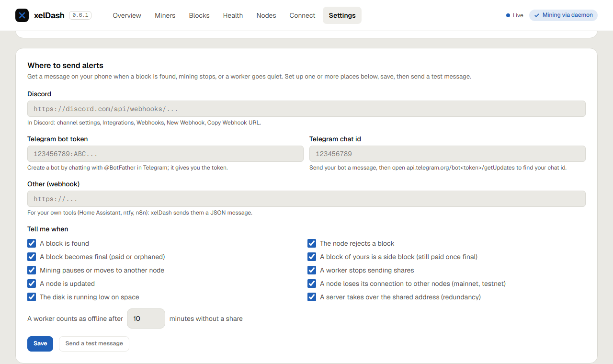
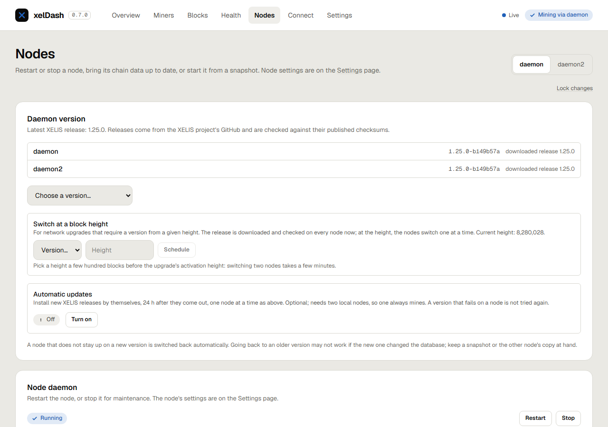
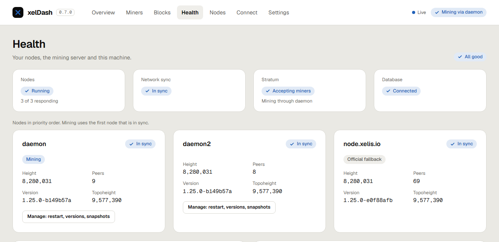
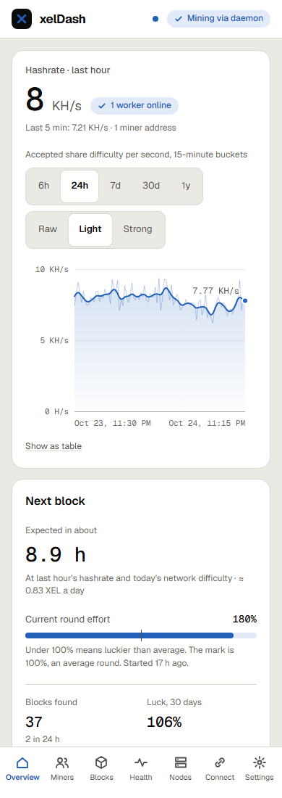
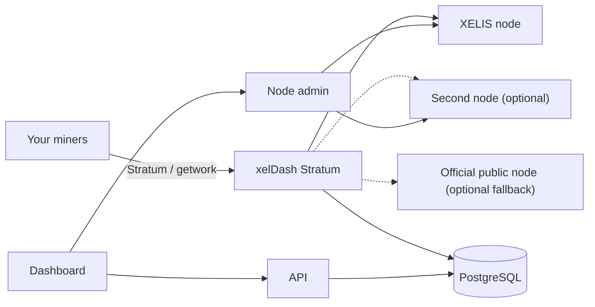

<p align="center">
  
</p>

<h1 align="center">xelDash</h1>

<p align="center">
  <b>Self-hosted XELIS solo mining, with the statistics of a pool.</b><br>
  Your node. Your miners. Your rewards. And a dashboard that shows exactly how it is going.
</p>

<p align="center">
  <a href="LICENSE"></a>
  
  
  
</p>

<p align="center">
  <a href="#features">Features</a> ·
  <a href="#screenshots">Screenshots</a> ·
  <a href="#how-it-works">How it works</a> ·
  <a href="#quick-start">Quick start</a> ·
  <a href="docs/README.md">Documentation</a>
</p>

<p align="center">
  <picture>
    <source media="(prefers-color-scheme: dark)" srcset="docs/images/overview-dark.png">
    
  </picture>
</p>

xelDash runs your own XELIS node, a mining server for your rigs, and a live dashboard, all
together with Docker Compose. Point your miners at it and every share is checked and counted,
so you see per-rig hashrate, rejected shares, luck and expected earnings, the way a pool would
show them.

It is **solo mining**: when one of your rigs finds a block, the reward goes straight to that
rig's own XELIS address. There is no pool, no fee, no balance and no wallet inside xelDash. It
holds no funds, ever.

## Why xelDash

- **Made for beginners.** No node or wallet experience needed: a one-step installer, a guided
  setup in the dashboard, plain-language help, and a link to the official XELIS web wallet if you
  need an address.
- **You keep everything.** Blocks are found on your own node and pay your own address.
- **You see everything.** Pool-grade statistics for a setup that is entirely yours.
- **It keeps mining.** A second node, an optional fallback to the official public node, and
  upgrades that go one node at a time mean restarts and new releases do not stop your rigs.
- **It is quick to run.** One `docker compose up`, on a machine on your LAN, or on a server as a public solo mining
  server for everyone.

## Features

### Easy to start

- **One-step installer.** Double-click `xeldash.cmd` on Windows, or run `./xeldash.sh` on macOS
  and Linux. It checks Docker, makes the passwords, picks the real XELIS network with the fast
  snapshot start, builds and starts everything, and opens the dashboard.
- **A guided setup in the dashboard.** Four steps with a progress bar and time left while your
  node downloads the blockchain, then your wallet address, then your first miner, then your
  first share. Every step says what it is and why.
- **Your address, checked by your own node.** Paste it and xelDash tells you plainly if it has a
  typo or belongs to the wrong network. No wallet yet? It links to the official XELIS web wallet
  ([wallet.xelis.io](https://wallet.xelis.io)). xelDash never handles wallets, recovery phrases
  or coins.
- **Copy-ready miner settings.** Your server's real address and port, your wallet address, and a
  ready-made command for each miner, each with a copy button. Common Stratum miners that send
  `address.worker` as their user name work too.
- **Plain language.** A short glossary, "it does not connect, what now?" tips, and a
  `xeldash lan on` command that opens xelDash to your home network safely.

<p align="center">
  <picture>
    <source media="(prefers-color-scheme: dark)" srcset="docs/images/setup-dark.png">
    
  </picture><br>
  <sub>The setup guide during a first install (sample values).</sub>
</p>

### Mining

- **Stratum and getwork.** Stratum (`xel/v3`) for GPU and CPU miners such as Rigel, optional
  Stratum over TLS, and getwork for the official `xelis_miner`.
- **Every share is validated** with the official XELIS Hash V3 code, so the numbers you see
  are real.
- **Difficulty that fits each rig.** Automatic per-connection tuning, or a fixed value from
  the miner's password (`d=50000`).
- **Fair to fast GPUs.** Shares that arrive just after a new block still count, so 5-second
  blocks do not waste your hashrate.
- **Per-address work.** Each miner mines to its own address; rewards never touch xelDash.

### Dashboard

- **Live overview:** hashrate, when the next block is expected, the current round's effort, blocks found (and how many in the
  last 24 hours), luck, what you earned in 30 days, your share of the network, shares, node health and recent blocks, updating
  as it happens.
- **Best share.** How close your best share came to a block (100% is one), this round, in the last day and ever, with a
  chart per bucket on the miner and worker pages.
- **Effort and luck.** See how far the current round is from an average block, and how the
  blocks you found compare. Recorded per share against the difficulty of the moment, so it
  stays true as the network changes.
- **Expected earnings** in XEL, and optionally in money with the XEL price in one of eleven
  currencies. Prices are fetched by your server, never by your browser.
- **Smooth, honest charts** from six hours to a year, with adjustable smoothing and the raw
  data kept behind the line, and a shares chart that shows accepted, stale and invalid shares. They draw in when they load,
  in your browser only; off in Settings, or when your system asks for less motion.
- **Miners and workers** with per-rig hashrate, the hashrate each miner reports about
  itself, rejected shares by reason, and a clean list that hides rigs that went away.
- **A notice, and an optional sound,** when one of your miners finds a block: the built-in chime or your own audio file, kept
  in your browser. The notice stays until you close it, and on another tab the page title says "Block found".
- **Blocks** with their final status, reward and the effort of the round that found them, a link
  to each in the official block explorer, the total rewards found so far, and a CSV download.
- **Light, dark or system mode** with five colour themes (Classic, the original look, is the default) or a main colour of your
  own, a layout that works on a phone and a tablet, and it can be installed as an app from the browser (nothing runs in the
  background).

<p align="center">
  <picture>
    <source media="(prefers-color-scheme: dark)" srcset="docs/images/best-share-dark.png">
    
  </picture><br>
  <sub>Best share: how close each 15 minutes came to a block. The gold dot is a block.</sub>
</p>

### Nodes that look after themselves

- **Two local nodes** with automatic failover and failback, and an **optional fallback to the
  official public node**. Mining pauses only when nothing can issue work, and resumes by
  itself.
- **Everything from the dashboard:** restart, stop and start each node; change any daemon
  setting, with plain-language explanations for the important ones; set trusted peers.
- **Snapshots:** download the official daily mainnet snapshot, or drop your own zip onto the
  page. Copy one node's chain into the other in minutes instead of syncing for days.
- **Daemon upgrades:** pick an official XELIS release and xelDash installs it one node at a
  time, checking it against the published checksums, waiting for each node to catch up, and
  rolling back a node that does not stay up.
- **Network upgrades on schedule:** switch at a specific block height for hard forks.
- **Optional automatic updates** for setups with two local nodes.
- **Mining does not depend on the database.** If it is down or restarting, rigs stay connected and keep mining, and
  everything is recorded, in order, when it is back.

### Stay informed

- **Alerts** to Discord, Telegram or any webhook, set up on the Settings page with a test
  message: blocks found, side blocks and final blocks, mining paused or resumed, workers
  offline, node updates started, finished or failed, low disk space, a node that has lost its peers, and failovers between
  two servers.
- **Metrics** for Prometheus and Grafana, off unless you turn them on: shares, hashrate, answer times, blocks, the database
  path and every node's state. Totals only, naming no miner. See [Operations](docs/OPERATIONS.md#metrics).
- **Connection help:** when a miner cannot connect (wrong address, wrong network, not on your
  network), the dashboard says why and what to change.
- **Events** for everything that happens to your nodes, on the dashboard.
- **A front door**: a small Linux box that miners connect to, forwarding them to your (Windows or Linux) main server and to its own
  Stratum when the main one is down or restarting. See [Operations](docs/OPERATIONS.md#front-door-a-box-miners-connect-to).
- **Redundancy** between two Linux servers that share one address: if one loses power or restarts, the other
  takes over within seconds and your miners need no change.
- **Backups** from the dashboard or the launcher (`xeldash backup`, `xeldash restore`), and optional daily
  automatic ones.
- **Public mode** (`XELDASH_PUBLIC_MODE=true`): a server anyone may solo mine on, each to their own address, with HTTPS from
  Let's Encrypt, a "Mine here" page, no miners' IP addresses on show, the operator's dashboard on the server's loopback only,
  and limits on everything reachable from the internet. See [Operations](docs/OPERATIONS.md#public-mode).

### Safe by default

- Listens on `127.0.0.1` until you open it to your LAN, and then accepts miners and dashboard
  visitors only from your own networks (on Windows, with firewall rules that block the internet).
- The database sits on an internal network that only the API and Stratum can reach.
- Changes to your nodes need an admin token, sent in a header, and nothing in xelDash can
  control Docker.
- Strict content security policy, per-IP limits and bans for abusive clients, checked snapshots
  and release downloads, and an optional HTTPS front with a login.
- A public server (public mode) shows no IP addresses or node administration to visitors, limits every connection, share
  and request per IP address, and never asks its XELIS node more than a set number of times a second.

See [Security](docs/SECURITY.md) for what is protected and what is not.

## Screenshots

<table>
  <tr>
    <td width="50%">
      <picture>
        <source media="(prefers-color-scheme: dark)" srcset="docs/images/blocks-dark.png">
        
      </picture>
      <p align="center"><sub><b>Blocks:</b> rewards found, the effort of each block, and luck</sub></p>
    </td>
    <td width="50%">
      <picture>
        <source media="(prefers-color-scheme: dark)" srcset="docs/images/alerts-dark.png">
        
      </picture>
      <p align="center"><sub><b>Alerts:</b> set up from the dashboard, with a test message</sub></p>
    </td>
  </tr>
  <tr>
    <td width="50%">
      <picture>
        <source media="(prefers-color-scheme: dark)" srcset="docs/images/nodes-dark.png">
        
      </picture>
      <p align="center"><sub><b>Nodes:</b> versions, upgrades, restart, copy, snapshots</sub></p>
    </td>
    <td width="50%">
      <picture>
        <source media="(prefers-color-scheme: dark)" srcset="docs/images/health-dark.png">
        
      </picture>
      <p align="center"><sub><b>Health:</b> every node and the mining status</sub></p>
    </td>
  </tr>
</table>

<p align="center">
  <br>
  <sub>The same dashboard on a phone</sub>
</p>

## How it works



Miners connect to xelDash's Stratum server. It asks your node for a block template for each
miner's own address, checks every share against it, and records the results. Only when a share
also meets the network's difficulty does it submit a block, to your node, before anything else
happens. The dashboard reads the recorded statistics, and a small admin service does the node
management. Details are in the [architecture guide](docs/ARCHITECTURE.md).

## Quick start

1. Check the [system requirements](docs/REQUIREMENTS.md) (about 40 GB of free disk, 4 GB of memory) and install **Docker Desktop**
   (Windows or macOS) or Docker Engine (Linux).
2. Download the **latest release** from the [Releases page](https://github.com/pitanu/xelDash/releases) (the **Source code (zip)** under the newest one) and unzip it.
   A release uses ready-made images, so it starts in a few minutes and `xeldash update` can move it to the next release. (**Code → Download ZIP** gives
   the development version instead, which builds everything on your computer and takes about ten minutes.)
3. **Windows:** double-click `xeldash.cmd`. **macOS and Linux:** run `./xeldash.sh` in a terminal.

The dashboard opens and guides you through the rest. You do not need a wallet before you start.

The [getting started guide](docs/GETTING-STARTED.md) explains every step for complete beginners,
including installing Docker and getting a wallet address, and has the manual setup for advanced
users. [Connecting miners](docs/MINERS.md) has the settings for each kind of miner.

## Status

xelDash 0.7.0 is an early release: 0.1.0 was the first public one, 0.2.0 added public mode, a server anyone may solo mine on, 0.3.0
records shares in batches, updates without a pause in mining when two nodes run, and uses far less processor time, 0.4.0 added
optional Prometheus metrics, 0.5.0 shows each address's best share: how close it came to a block, and 0.6.0 added your own
block sound, a block notice that stays, and chart animations, and 0.7.0 gives the dashboard a new look, with colour themes. It has been run on XELIS mainnet with two nodes, failover, rolling and scheduled
upgrades, and a GPU mining through it, and it has an automated test suite (`npm test`, run in CI). Some of it has only been
tried on one Windows PC. The [community testing list](docs/COMMUNITY-TESTING.md) says what is still unverified and how to help: a
result from your own hardware or miner, good or bad, is a real contribution (the
[miner compatibility template](https://github.com/pitanu/xelDash/issues/new?template=miner_compatibility.yml) is the quickest way to report a miner).

**Known limits**

- **Miners.** Rigel 1.23.0 is tested on mainnet with a GPU, and the official `xelis_miner` (getwork) on a devnet. A community tester on
  Linux reports SRBMiner, Rigel, OneZeroMiner and ForgeMiner working (see [Connecting miners](docs/MINERS.md)). BzMiner, lolMiner and
  others follow the same Stratum protocol and should work, but nobody has tried them yet: reports are welcome.
- **Systems.** The Windows installer has been run end to end. The Linux and macOS launcher's setup step has been run only in a
  Linux container (not on real Linux or macOS machines), and the Raspberry Pi (arm64) images and the Intel macOS case have not been run.
- **Two-server redundancy and the front door** are tested with containers on one computer (failover timing, data kept and replayed,
  real miner addresses preserved), not yet on separate computers or with a Windows main server. Treat them as new.
- **Wallets.** xelDash does not handle wallets or keys; rewards go straight to your address.
- **Not covered by automated tests:** most of the dashboard's pages (the tests cover the setup guide, the public view, the notices, connection
  problems and alert settings), the PowerShell launcher beyond its update flow and a syntax check, and anything that needs real hardware.

## Documentation

Everything else lives in [docs/](docs/README.md):

| | |
|---|---|
| [System requirements](docs/REQUIREMENTS.md) | Disk, memory, processor and network, minimum and recommended |
| [Getting started](docs/GETTING-STARTED.md) | Install, configure, first run |
| [Connecting miners](docs/MINERS.md) | Settings for Rigel, SRBMiner, `xelis_miner` and others |
| [Operations](docs/OPERATIONS.md) | Alerts, backups, HTTPS, snapshots, second node, upgrades |
| [Security](docs/SECURITY.md) | The model, the protections, the remaining risks |
| [Architecture](docs/ARCHITECTURE.md) | Services, protocols, data model |

## Built with

Node.js and PostgreSQL for the services, React, Vite and Tailwind for the dashboard, and the
official XELIS daemon and [XELIS Hash V3](https://github.com/xelis-project/xelis-hash) code
(compiled into a small Rust addon) for validation. Images are built for amd64 and arm64.

## Support the project

xelDash is free, with no fees and no ads, and is made by one person. If it is useful to you, you can send a little XEL to the
maintainer's mainnet wallet. It is entirely optional and nothing in xelDash depends on it.

```
xel:060exlhsp28xzkxf8zpa04kw33dgs7tcqu8sq8zntddf9h7wmvusqy82lgk
```

The dashboard shows the same address on its Settings page (mainnet only), and once, dismissibly, after your miners find a block.
xelDash never sends anything for you: copy the address and send from your own wallet. If the dashboard and this page ever show
different addresses, trust this page on GitHub. Stars, bug reports, miner compatibility reports and pull requests help just as much.

## Contributing

Bug reports, miner compatibility reports and pull requests are welcome. See
[CONTRIBUTING.md](CONTRIBUTING.md). Changes are listed in the [changelog](CHANGELOG.md).

## License

[MIT](LICENSE). The XELIS Hash V3 code built into the Stratum image comes from
[xelis-project/xelis-hash](https://github.com/xelis-project/xelis-hash), also MIT.

## Disclaimer

xelDash is an independent community project. It is not made, endorsed or supported by the XELIS team, and it is not an official
XELIS product. It comes with no warranty (see the [license](LICENSE)). Mining can cost more in electricity and hardware than it
earns, and a solo miner may wait a long time for a block; nothing here is financial advice. xelDash never holds your coins:
rewards go straight to the wallet address you choose, and it does not handle wallets or keys. You are responsible for your own
computers, network and wallet.
